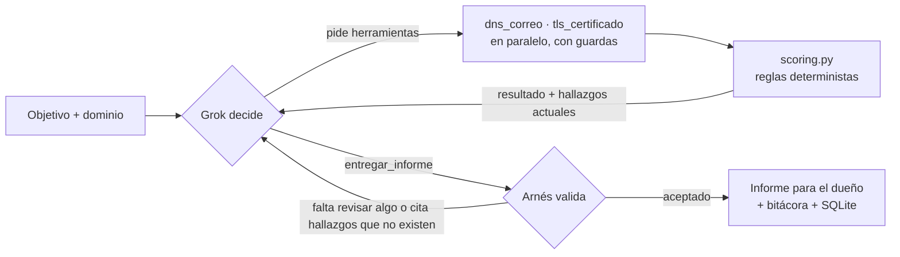

# Auditor de exposición digital para pymes

Agente autónomo que revisa, **solo con información pública**, qué tan expuesto está el dominio de una pyme colombiana a la **suplantación de su correo y a fraudes con su nombre**, y entrega al dueño un **plan de acción priorizado**, en lenguaje simple y con el dato técnico exacto listo para reenviar a su proveedor.

Proyecto del Track 1 del [Reto Agente 2026](https://reto.pltk.mx/) (Platica.mx × Campuslands). El razonamiento corre sobre **Grok** (grok-4.7) a través del gateway del reto.

```powershell
python -m auditor auditar ejemplo.com.co --verbose
```

> **Estado:** hito S1 completo: agente de extremo a extremo sobre Grok, probado con dominios reales de 6 perfiles distintos. Ver [Estado y hoja de ruta](#estado-y-hoja-de-ruta).

---

## El problema

Las pymes colombianas usan su dominio para el correo y la web, pero la mayoría no configura las protecciones que permiten a los receptores reconocer un correo falso (SPF, DKIM, DMARC). El resultado:

- **Facturas y cambios de cuenta bancaria "desde" su correo.** Sin DMARC, el dominio no les indica a los receptores qué hacer con correos falsificados, y el dueño no recibe reportes. Filtrarlos queda a criterio de cada proveedor de correo.
- **Certificados vencidos o mal instalados**, que hacen que el navegador advierta a sus clientes y facilitan que un sitio falso pase por el suyo.
- **El dueño no lo sabe**, y aunque lo supiera, no sabe qué pedirle a su proveedor.

Herramientas como MXToolbox o internet.nl ya hacen chequeos técnicos gratis, pero entregan un tablero para técnicos. Este agente entrega **un plan**: qué hacer primero, por qué, en palabras del dueño, y el registro exacto que su proveedor debe publicar. Los cambios se proponen de forma **gradual**, para no mandar a spam correos legítimos como la facturación electrónica.

## Qué hace



1. Grok recibe el objetivo, por defecto *"Evalúa qué tan expuesto está X a suplantación de correo y fraudes…"*, o uno en texto libre con `--objetivo`.
2. **Grok decide** qué herramientas usar, en qué orden y sobre qué hosts; puede pedir varias a la vez.
3. El código ejecuta las herramientas **pasivas**, calcula los **hallazgos** con reglas fijas y se los devuelve a Grok.
4. Cuando Grok considera que tiene suficiente, llama a `entregar_informe`. El arnés **lo rechaza** si falta revisar el correo o el certificado del dominio, si cita un hallazgo que no existe o si omite uno crítico o alto.
5. Se genera el informe en Markdown, cada paso queda en la bitácora (tokens, costo y latencia) y la auditoría se registra en SQLite.

## Por qué es un agente y no un script

**Grok investiga, el código concluye.**

- **Grok elige el camino** según lo que va encontrando: qué revisar, en qué orden y cuándo tiene suficiente para entregar. Cada auditoría tiene topes (15 pasos, USD 0,15 y 180 s). En esta versión, con dos herramientas, alcanzan con holgura; desde el S2, con subdominios y dominios parecidos por revisar, habrá más candidatos que pasos, y Grok tendrá que priorizar. Cada decisión queda en la bitácora con una justificación de una línea.
- **Las conclusiones las calculan reglas deterministas en el código:** cada hallazgo tiene id, severidad y evidencia exacta. Grok no puede crear hallazgos ni cambiar su severidad, y el **nivel de riesgo también lo calcula el código**.
- **Grok redacta y prioriza** el plan para el dueño, pero los **datos técnicos** (el registro DNS exacto) los pone el código, literales, desde plantillas revisadas.
- **Los textos que vienen de afuera** (registros TXT, nombres y emisor del certificado) viajan aparte como *contenido no confiable* y nunca entran a la evidencia, así que una inyección de prompts no cambia los hallazgos.

**Trayectorias reales distintas** (dominios seudonimizados, auditorías del 12/10/2026):

| Dominio | Lo que Grok decidió |
|---|---|
| `pyme-e.com.co` (el dominio no tiene sitio web propio) | Revisó correo y certificado; al ver `sin_direccion_web`: *«El dominio raíz no tiene sitio; reviso el certificado de www, que es el host público habitual.»*, y lo revisó. |
| `pyme-b.com.co` (Google Workspace, sin DMARC) | Exploró `mail.`, `webmail.`, `pagos.` y `admin.` por ser *«sensibles para fraudes»*; ante un tiempo agotado: *«Reintento único de webmail… para no dejar ese host sensible sin revisar»*; como `mail.` falló en TLS, revisó su configuración de correo. |
| Un dominio inexistente | Al ver `dominio_no_existe`, entregó en 2 pasos sin más revisiones. |

## Alcance ético y legal

- Solo **verificaciones pasivas de información pública**: consultas DNS y el saludo TLS al puerto 443 para leer el certificado. Sin escaneos de puertos, sin intentos de acceso, sin formularios y sin pedir páginas.
- **Anti-SSRF:** antes de conectarse se resuelve la IP y se bloquean rangos privados, loopback, link-local y especiales (también disfrazados, como `::ffff:10.0.0.1`), y se conecta a esa misma IP.
- **Guarda de alcance:** ninguna herramienta acepta un dominio distinto del objetivo o sus subdominios; los intentos quedan en la bitácora como `rechazo`.
- **User-Agent identificable** para las consultas HTTP previstas en el S2: `AuditorPymeBot/1.0 (+URL de este repo)`.
- Los ejemplos publicados usan **dominios seudonimizados**.

## Instalación y uso (Windows)

Requiere Python 3.12 o superior (probado en 3.14) y una llave del reto.

```powershell
python -m venv venv
venv\Scripts\python.exe -m pip install -r requirements.txt
copy .env.example .env          # luego escribe tu llave en RETO_KEY=pk_...
venv\Scripts\python.exe -m pytest -q                                   # 251 pruebas, sin red ni llave
venv\Scripts\python.exe -m auditor auditar ejemplo.com.co --verbose     # auditoría completa
```

Opciones: `--objetivo "texto libre"`, `--modelo grok-4.20` (solo los modelos permitidos por el reto) y `--verbose` (muestra en vivo cada decisión de Grok).

| Salida | Dónde |
|---|---|
| Informe para el dueño | `salidas/<dominio>-<fecha>.md` |
| Bitácora (un evento JSON por línea) | `logs/bitacora-AAAAMMDD.jsonl` |
| Registro de auditorías | `cache/auditor.db` (SQLite) |

Códigos de salida: `0` terminó bien · `1` dominio inválido · `2` falta configuración (llave o modelo no permitido).

La llave **nunca** va al repositorio: `.env` está en `.gitignore` y la bitácora enmascara cualquier texto con forma de llave.

## Ejemplo real

`pyme-f.com.co` (seudónimo) tenía **dos registros DMARC a la vez**, los dos con `p=reject`. Con dos registros, los receptores no aplican ninguno. Extracto del informe:

> **Nivel de riesgo: 🔴 ALTO**
>
> Revisé la protección pública del correo de pyme-f.com.co y el certificado del sitio. El sitio abre con conexión segura y el certificado sigue vigente. La defensa contra correos que se hacen pasar por ustedes no está bien armada: hay dos avisos de política a la vez, y por eso esa protección puede no aplicarse.
>
> **1. El registro DMARC está mal formado** · *Severidad alta · CORREO-DMARC-INVALIDO*
>
> Pida a quien administra el dominio que deje un solo aviso de política de correo… Antes de cambiar quién puede enviar correo a su nombre, confirme con su proveedor qué servicios lo hacen hoy.
>
> **Reenvíe esto a su proveedor:**
> ```
> Dejar un único registro TXT en _dmarc.pyme-f.com.co, conservando la política más estricta que ya tiene (p=reject) y uniendo en él las direcciones rua de los registros actuales:
> v=DMARC1; p=reject; rua=mailto:dmarc@pyme-f.com.co
> ```

El texto lo redactó Grok; el bloque técnico lo puso el código, que **conserva la política más estricta existente** en lugar de proponer una más débil. Extracto de la bitácora de esa auditoría (campos abreviados):

```json
{"paso": 1, "tipo": "llm", "modelo": "grok-4.7", "tokens_entrada": 2328, "tokens_cache": 1152, "tokens_razonamiento": 161, "costo_usd": 0.004356, "latencia_ms": 3563}
{"paso": 1, "tipo": "herramienta", "herramienta": "dns_correo", "ok": true, "latencia_ms": 278, "justificacion": "Revisar MX, SPF y DMARC del dominio objetivo para evaluar riesgo de suplantación de correo."}
{"paso": 2, "tipo": "llm", "tokens_entrada": 3289, "tokens_cache": 2304, "tokens_razonamiento": 1639, "costo_usd": 0.014798, "latencia_ms": 27702}
{"paso": 2, "tipo": "fin", "costo_usd": 0.019154, "motivo_cierre": "informe_entregado"}
```

## Qué revisa (S1) y qué no

| Revisa | Hallazgos posibles |
|---|---|
| **Correo** (`dns_correo`): MX y proveedor; SPF con conteo **recursivo** de consultas (RFC 7208); DMARC según **RFC 9989** | DMARC ausente, inválido o duplicado, en `p=none`, sin reportes o con etiquetas obsoletas · SPF ausente, múltiple, `+all`, sin cierre o con más de 10 consultas · sin MX |
| **Sitio** (`tls_certificado`): validez del certificado, motivo, vencimiento y versión de TLS | Certificado inválido (vencido, autofirmado, nombre que no coincide, raíz no confiable), por vencer (15 días o menos), TLS 1.0/1.1, sin HTTPS |

Criterios actualizados a 2026: `~all` **no** se marca como débil cuando DMARC está en `quarantine` o `reject` (es lo que recomiendan Google y M3AAWG), y DMARC siempre se recomienda de forma gradual.

**No hace** (y el informe lo declara): no afirma nada sobre DKIM en esta versión; no detecta ataques en curso; no revisa contraseñas, cuentas ni vulnerabilidades del sitio; no es un pentest: mide exposición, no compromiso.

## Arquitectura

```
auditor/
  __main__.py    CLI: python -m auditor auditar <dominio> [--objetivo] [--modelo] [--verbose]
  config.py      modelos permitidos, precios, topes por auditoría, tiempos y rutas
  modelos.py     contrato de datos (Pydantic): resultado de herramienta, hallazgo, informe, estado
  llm.py         cliente de Grok: costo real por llamada, caché por conversación, reintentos y errores con nombre
  agent.py       bucle del agente: topes, repeticiones, verificador de completitud, validador del informe
  scoring.py     reglas deterministas -> hallazgos y nivel de riesgo
  report.py      informe para el dueño, con plantillas técnicas fijas por recomendación
  store.py       registro de auditorías en SQLite
  bitacora.py    bitácora JSONL de esquema fijo; enmascara cualquier llave
  tools/
    base.py      registro de herramientas, normalización, guarda de alcance, anti-SSRF; nunca lanza excepciones
    correo.py    dns_correo (lectores puros de SPF/DMARC + consulta DNS)
    web.py       tls_certificado
scripts/probar_gateway.py   medición de lo que soporta el gateway del reto
tests/                      251 pruebas, sin red ni llave (Grok simulado con guiones)
```

**Decisiones de diseño:**
- **SDK propio sobre la librería `openai`, sin framework:** los topes, el validador del informe y la bitácora son lógica propia en cualquier caso, y así cada parte es visible y probada.
- **Costo real, no estimado:** cada llamada registra el costo que reporta el propio gateway (`cost_in_usd_ticks`), verificado contra nuestro cálculo con los precios publicados.
- **Siempre hay informe:** si se alcanza un tope o el gateway falla, el arnés cierra con un informe de respaldo armado por código con los hallazgos verificados.
- **Errores con nombre, nunca excepciones:** `dominio_no_existe`, `sin_direccion_web`, `sin_https`, `tiempo_agotado`, `fuera_de_alcance`… vuelven como resultados que Grok puede razonar.
- **Identidad lote > auditoría > intento:** prepara la corrida masiva del S4 para que se reanude tras una caída sin contar dos veces la misma auditoría.

## Pruebas y verificación con datos reales

- **251 pruebas automáticas** que corren sin red y sin llave: lectores de SPF y DMARC, guardas de alcance y anti-SSRF, cada regla de scoring, el bucle completo con un Grok simulado (topes, repeticiones, entregas incompletas, informes inválidos, errores del gateway), reintentos, informe, almacenamiento y CLI.
- **Dominios reales de 6 perfiles** (seudonimizados), auditados por la CLI con Grok:

| Perfil | Dominio | Resultado |
|---|---|---|
| Pyme con Google Workspace | pyme-b.com.co | 🔴 alto · DMARC ausente → DMARC en modo de observación |
| Sin DMARC, sin SPF y sin MX | pyme-c.com.co | 🔴 alto · recomendaciones coherentes para "envía / no envía correo" |
| Bien configurado | empresa-d.com.co | 🟢 bajo · solo una nota informativa, sin inventar problemas |
| Sin sitio web propio | pyme-e.com.co | 🟢 bajo · `sin_direccion_web` y Grok revisa www |
| Inexistente | (aleatorio) | "El dominio no existe", sin semáforo |
| DMARC duplicado | pyme-f.com.co | 🔴 alto · conserva `p=reject` |

  Además: `expired.badssl.com`, `self-signed.badssl.com`, `wrong.host.badssl.com` y `untrusted-root.badssl.com` dan el motivo correcto del certificado.

## Costo medido

Sobre **23 auditorías reales** por la CLI (12 dominios distintos, octubre de 2026), con grok-4.7:

| | Mínimo | Mediana | Máximo |
|---|---|---|---|
| Costo por auditoría | USD 0,007 | **USD 0,016** | USD 0,045 |
| Pasos de Grok | 2 | 2 | 4 |
| Duración | 7 s | 22 s | 108 s |

Todas cerraron con el informe de Grok aceptado por el arnés (23/23, ninguna con informe de respaldo). A ese costo, las 1.000 auditorías del S4 costarían alrededor de USD 16.

## Estado y hoja de ruta

| Hito | Contenido | Estado |
|---|---|---|
| **S1** · agente corriendo | Gateway medido · contrato de datos · bitácora · cliente de Grok · `dns_correo` y `tls_certificado` · scoring · agente con topes y validador · informe · SQLite · CLI · 6 perfiles reales | ✅ |
| **S2** · herramientas reales | Dominios parecidos con correo configurado (DNS + WHOIS) · subdominios por Certificate Transparency · cabeceras de seguridad · DKIM por selector · informe HTML · video | ⏳ |
| **S3** · datos reales | Set de evaluación de 30+ casos · costo por tarea · comparación de modelos | ⏳ |
| **S4** · carga | 1.000 auditorías en 12 h desatendido, con cola reanudable · estadística agregada de dominios `.com.co` | ⏳ |

## Licencia

[MIT](LICENSE).
